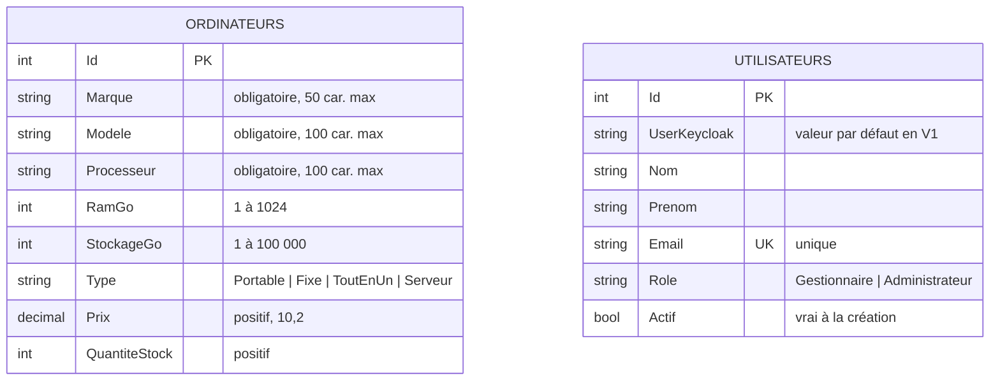

# RepairIT

Application de gestion d'un prestataire de **vente et de réparation d'ordinateurs**, développée en C# / .NET 10
sous forme de micro-services (ASP.NET Core Web API) avec un front **Blazor WebAssembly**.

Le projet est livré version par version. Ce document décrit la **version 1 : Catalogue informatique**.

---

## Contenu de la version 1

| Attendu du sujet (V1) | Réalisation |
|---|---|
| Création de la solution | Solution `RepairIT.slnx` |
| Création des différents projets (front et APIs) | Front Blazor, 5 Web API, une librairie partagée, un projet de tests |
| CRUD Ordinateurs | `RepairIT.CatalogService` : `GET / GET {id} / POST / PUT {id} / DELETE {id}` sur `api/ordinateurs` |
| Gestion des utilisateurs (création, sans Keycloak) | `RepairIT.UserService` : création et consultation sur `api/utilisateurs`, champ `UserKeycloak` rempli avec une valeur par défaut |
| EF Core + base SQLite | Une base SQLite par micro-service (`catalogue.db`, `utilisateurs.db`), migrations EF Core |
| Initialisation de la base | Au démarrage : application des migrations puis insertion d'un jeu de données si la base est vide |
| Quelques tests unitaires | 35 tests xUnit (+ Moq), couverture ≈ 97 % des lignes |
| Injection de dépendances, Logging, Configuration | Services injectés via interfaces, `ILogger<T>` dans services et contrôleurs, `appsettings.json` + pattern Options |
| Script de lancement | `start.cmd` lance tous les projets en une fois |
| Intégration continue | GitHub Actions : restauration, compilation, tests, couverture (affichée, seuil 50 %) |

Hors périmètre V1 (versions suivantes) : clients et réparations (V2), ventes (V3), consommation des APIs par le
front et Gateway (V4), Keycloak, sécurisation et Docker (V5).

---

## Architecture

```
RepairIT/
├── RepairIT.slnx
├── RepairIT.Client                   Front Blazor WebAssembly (port 5000)
├── RepairIT.CatalogService           Web API catalogue des ordinateurs (port 5001)  ✅ V1
├── RepairIT.UserService              Web API utilisateurs (port 5002)               ✅ V1
├── RepairIT.RepairService            Web API réparations et clients (port 5003)     squelette → V2
├── RepairIT.SalesService             Web API ventes et statistiques (port 5004)     squelette → V3
├── RepairIT.AuthentificationService  Web API authentification (port 5005)           squelette → V5
├── RepairIT.Shared                   Modèles et DTO partagés (classlib)
├── RepairIT.Tests                    Tests unitaires xUnit + Moq
├── coverlet.runsettings              Paramètres de couverture de code
├── start.cmd                         Lancement de tous les projets (Windows)
└── .github/workflows/ci.yml          Intégration continue
```

Chaque Web API suit la même organisation :

```
Controllers/   points d'entrée REST (aucune logique métier)
Services/      interface + implémentation de la logique métier
Data/          DbContext EF Core et initialisation de la base
Migrations/    migrations EF Core générées
```

### Choix techniques

- **Une base par micro-service** : le catalogue et les utilisateurs ont chacun leur base SQLite. Aucun service
  n'accède à la base d'un autre, ce qui prépare le découpage en conteneurs (V5).
- **Interfaces + injection de dépendances** : les contrôleurs dépendent de `IOrdinateurService` /
  `IUtilisateurService`, enregistrés en `Scoped` (même durée de vie que le `DbContext`). Cela permet de simuler les
  services avec Moq dans les tests.
- **Configuration** : la chaîne de connexion (`ConnectionStrings`) et la description du service (`Application`)
  sont dans `appsettings.json`. La section `Application` est liée à la classe `ApplicationOptions` (pattern Options)
  et exposée par `GET /api/info` sur chaque service.
- **Logging** : `ILogger<T>` injecté ; les messages utilisent des paramètres structurés (`{Id}`) plutôt que de la
  concaténation.
- **Validation** : les annotations des modèles (`[Required]`, `[Range]`...) sont vérifiées automatiquement par
  `[ApiController]`, qui renvoie un `400` détaillé si la requête est invalide.
- **DTO de création d'utilisateur** : l'appelant ne fournit que nom, prénom, e-mail et rôle. L'identifiant, le lien
  Keycloak et l'état du compte sont fixés par le service.
- **Énumérations en texte** : `TypeOrdinateur` et `RoleUtilisateur` circulent en JSON (`"Portable"`) et sont
  stockées en texte en base, pour rester lisibles.
- **Front** : squelette Blazor avec le menu demandé et un thème personnalisé (pas l'interface Blazor par défaut).
  Les écrans métier consommeront les APIs en V4 ; en attendant, l'accueil renvoie vers le Swagger des APIs de la V1.
  Aucune page de connexion n'est développée : la connexion passera par la page de Keycloak (V5).

---

## Modèle de données



- Base `catalogue.db` : table `Ordinateurs`.
- Base `utilisateurs.db` : table `Utilisateurs`. **Aucun mot de passe n'est stocké** : l'authentification sera
  entièrement gérée par Keycloak. En V1, `UserKeycloak` vaut `00000000-0000-0000-0000-000000000000`.

### Données initiales

Au premier démarrage, chaque service applique ses migrations puis insère :

- **Catalogue** : 5 ordinateurs (Dell, HP, Lenovo, Apple, Asus).
- **Utilisateurs** : 1 administrateur et 4 gestionnaires (répartition demandée pour Keycloak en V5).

Pour repartir d'une base vierge, il suffit de supprimer le fichier `.db` du service : il sera recréé au lancement.

---

## API de la version 1

### Catalogue — `http://localhost:5001/swagger`

| Méthode | Route | Réponses |
|---|---|---|
| GET | `/api/ordinateurs` | 200 liste triée par marque puis modèle |
| GET | `/api/ordinateurs/{id}` | 200, 404 |
| POST | `/api/ordinateurs` | 201 (+ en-tête `Location`), 400 si invalide |
| PUT | `/api/ordinateurs/{id}` | 204, 400 si l'id du corps diffère de l'URL, 404 |
| DELETE | `/api/ordinateurs/{id}` | 204, 404 |

Exemple de corps :

```json
{
  "marque": "Dell",
  "modele": "Latitude 5440",
  "processeur": "Intel Core i5-1335U",
  "ramGo": 16,
  "stockageGo": 512,
  "type": "Portable",
  "prix": 1099.00,
  "quantiteStock": 8
}
```

### Utilisateurs — `http://localhost:5002/swagger`

| Méthode | Route | Réponses |
|---|---|---|
| GET | `/api/utilisateurs` | 200 liste triée par nom puis prénom |
| GET | `/api/utilisateurs/{id}` | 200, 404 |
| POST | `/api/utilisateurs` | 201, 400 si invalide, 409 si l'e-mail existe déjà |

```json
{ "nom": "Dupont", "prenom": "Jean", "email": "jean.dupont@repairit.fr", "role": "Gestionnaire" }
```

### Tous les services

`GET /api/info` renvoie le nom et la version du service, lus dans la configuration.

---

## Lancer le projet

Prérequis : [SDK .NET 10](https://dotnet.microsoft.com/download).

**Windows, tout en une fois :** double-cliquer sur `start.cmd` (ou l'exécuter depuis un terminal). La solution est
compilée une fois, puis chaque projet s'ouvre dans sa propre console.

**Un projet seul :**

```bash
dotnet run --project RepairIT.CatalogService
```

| Projet | URL |
|---|---|
| Front Blazor | http://localhost:5000 |
| Catalogue | http://localhost:5001/swagger |
| Utilisateurs | http://localhost:5002/swagger |
| Réparations (squelette) | http://localhost:5003/swagger |
| Ventes (squelette) | http://localhost:5004/swagger |
| Authentification (squelette) | http://localhost:5005/swagger |

### Migrations EF Core

Les migrations sont déjà générées. Pour en ajouter une après une modification du modèle :

```bash
dotnet tool install --global dotnet-ef
dotnet ef migrations add NomDeLaMigration --project RepairIT.CatalogService
```

Elles sont appliquées automatiquement au démarrage du service.

---

## Tests et couverture

```bash
dotnet test RepairIT.slnx --settings coverlet.runsettings --collect:"XPlat Code Coverage"
```

- **Outils** : xUnit, Moq, fournisseur EF Core InMemory (une base isolée par test).
- **Ce qui est testé** : services métier (CRUD, règles comme l'unicité de l'e-mail), contrôleurs (codes HTTP, avec
  services simulés par Moq) et initialisation des bases. Le front n'est pas testé, conformément à la stratégie de
  tests du sujet.
- **Exclusions de couverture** (`coverlet.runsettings`) : les migrations (code généré par EF Core) et les
  `Program.cs` (configuration d'hébergement, non testable unitairement).

## Intégration continue

Le workflow `.github/workflows/ci.yml` s'exécute à chaque commit poussé et à chaque Pull Request. Il fait
uniquement de l'intégration continue (pas de déploiement) :

1. restauration des dépendances ;
2. compilation (Release) ;
3. exécution des tests unitaires ;
4. calcul de la couverture (coverlet) et publication du rapport (ReportGenerator) dans le résumé de l'exécution,
   plus le rapport HTML en artefact ;
5. échec du workflow si la couverture des lignes est inférieure à **50 %**.

## Branches

- `production` : dernière version livrée, branche évaluée.
- Chaque version est développée sur sa propre branche puis livrée par Pull Request vers `production`.
